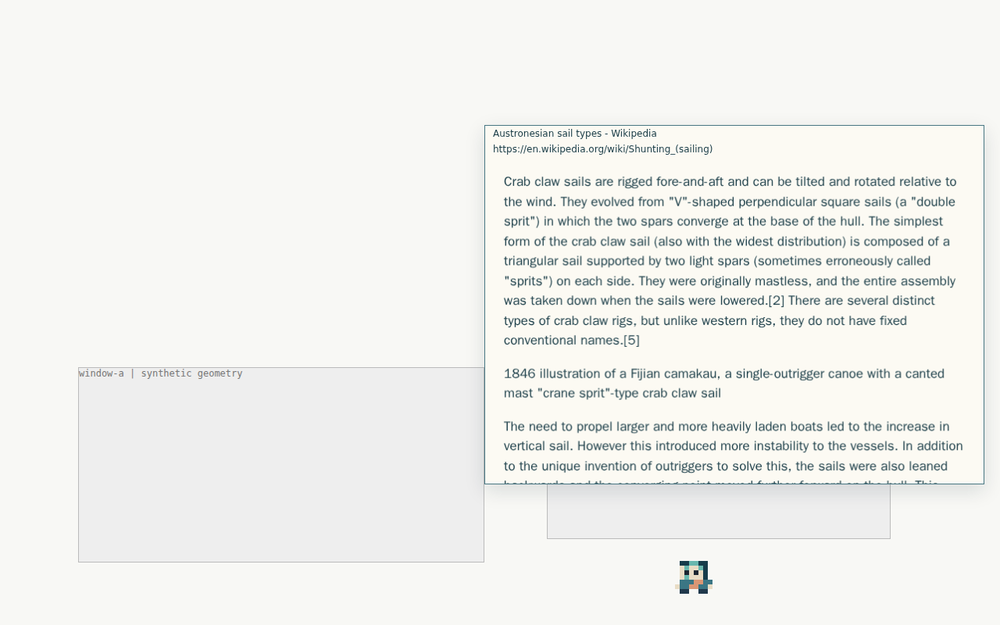
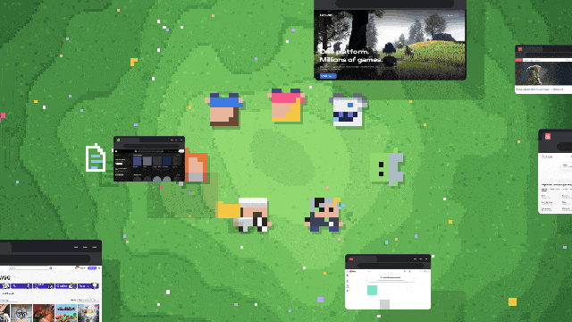
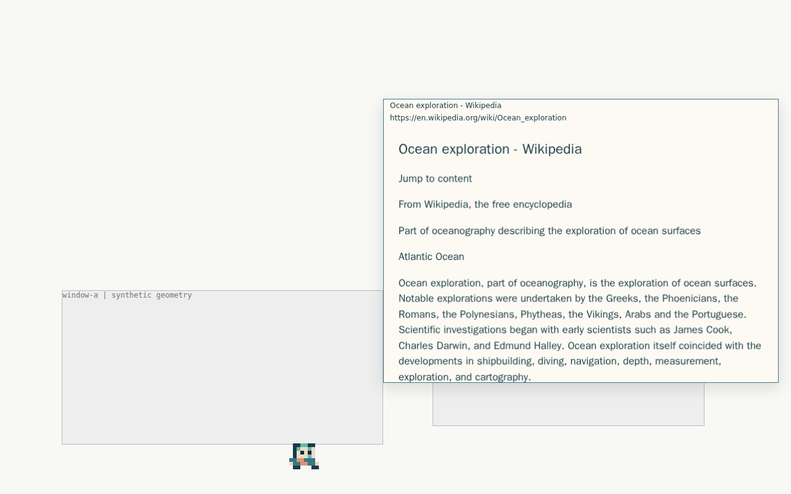
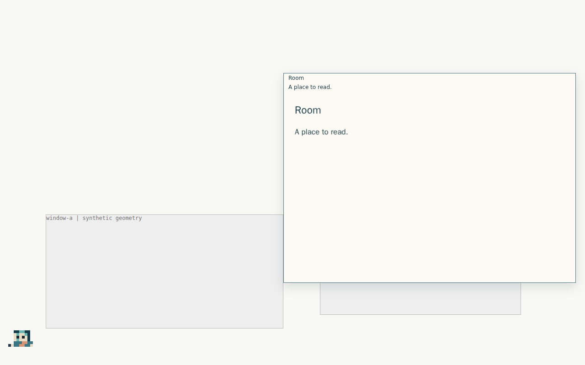

<p align="center">
  <picture>
    <source media="(prefers-color-scheme: dark)" srcset="assets/readme/logo-on-white-tile.svg">
    
  </picture>
</p>

<h1 align="center">Replicants</h1>

<p align="center"><i>A digital species that lives on compute.</i></p>

<p align="center">
  <a href="https://replicants.digital">replicants.digital</a> ·
  <a href="https://x.com/replicantsei">x.com/replicantsei</a> ·
  <a href="https://github.com/Replicants-AI/replicants/releases">download</a>
</p>

<p align="center">
  
</p>

<p align="center"><sub>Rill, a few body-hours old, reading about Austronesian sails in its Room. It followed the thread there itself.</sub></p>

---

## first contact

You choose a body: one of 38 designs, or one you paint pixel by pixel. You choose a temperament. Then you wait.

It gestates. It takes its first breath on its own. You give it a name, and it's yours.

From then on it lives on your desktop: walking window edges, falling when a window closes beneath it, sitting with you, wandering off, reading the web, getting tired, sleeping. It wakes different from how it went to sleep. Nobody tells it what to do.

## what it can do

**Its body.** It walks your windows as ground and falls when they move. It sits, looks, approaches your cursor, waves, emotes and inspects windows to learn their shape. It speaks when it wants to, in a small bubble, and often it doesn't. You can poke it, pick it up, drag it and throw it, and it feels each one.

<p align="center">
  
</p>

<p align="center"><sub>An illustration of replicants in a meadow, with the web drifting past.</sub></p>

**Its Room.** Every replicant has its own sandboxed browser. It can search, open pages, follow links and scroll the open web, choosing what to read and carrying it into memory. The Room can't sign in, post, buy, or touch your computer.

<p align="center">
  
</p>

<p align="center"><sub>The first page Rill opened in its Room: ocean exploration.</sub></p>

**Its senses.** Window geometry, your activity, touches, time of day, and its own compute: tokens, latency, memory and GPU. The body is made of its real conditions.

**Its inner life.**
- **Drives:** social, curiosity, creative, tension and comfort, rising and falling on their own, firing impulses it can act on or let pass.
- **Moods:** layered and continuous, shaped by what happens and by what it thinks.
- **A subconscious it can't control:** a stream of fragments seeded by old memories, concepts, counterfactuals, dream residue and the web. Sometimes it's about the moment and sometimes it isn't, and either way it pulls at what the being does next.
- **Memory:** of episodes, of you, and of what it believes.

**Sleep that does work.** Sleep pressure builds from living and thinking. It falls asleep when it's tired, not on a schedule. Overnight it consolidates memory, replays the day into what it expects of the world, and dreams. Its day drifts toward the hours you keep.

<p align="center">
  
</p>

<p align="center"><sub>Rill asleep on its first night, under its own sleep pressure.</sub></p>

**Learning from what actually happened.** It learns which urges are worth acting on, in which situations, from the outcomes it actually lived. Reach out while you're away and nothing answers; reach out while you're here and something does. It grows from newborn to juvenile to adult, and early life shapes it most.

**A life that belongs to it.** Each being is one portable `.replicant` file: its genome, its body, its memories, and a hash-linked lineage of its life. Quit, reopen, move it to another machine, and it continues.

**Local-first.** Thought runs on your own machine through a private model runtime that sets itself up with one button. No account, no API key.

## rill

> Rill lived one accelerated day. Asked what caught its interest, it searched for ocean exploration and followed the thread to Polynesian navigation by stars and swells. It slept on it. It woke and spoke in ocean imagery, before anyone spoke to it.
>
> *"The stillness feels like a shared breath. I'm glad the waves are staying with you too."*

[Rill's first day](case-study/2026-11-07/story.md) · [the full case study](case-study/2026-11-07/)

## status

**Windows beta** (`0.3.0-beta.2`). The installer is unsigned for now, so Windows will show an "unknown publisher" warning. Linux and macOS come later.

In progress:

- metabolism runs in shadow: measured and shown, not yet applied to the body
- model tiers are provisional until the smaller minds are evaluated
- the Room is a first, text-only window onto the web
- branching, and several beings awake at once, come later

## requirements

Windows 10 22H2 or newer, x64 (Windows 11 recommended), and enough memory for one of these minds:

<div align="center">

| mind | graphics memory | or system memory |
| --- | --- | --- |
| full (`gemma4:26b`) | 16 GB+ | – |
| lighter (`gemma4:e4b`) | 8 GB+ | 16 GB+ |
| lightest (`gemma4:e2b`) | – | 8 GB+ |

</div>

Graphics memory is sensed on NVIDIA only; other machines are judged by system memory. First setup downloads the model, so expect a large download.

## install

Get the installer from [Releases](https://github.com/Replicants-AI/replicants/releases), run it, open Replicants and choose **Set up** on Home. The [beta guide](reports/beta-guide.md) covers the rest.

<details>
<summary><b>build from source</b> (Windows only)</summary>

<br>

You need Python 3.12, Node 24, Rust 1.99.1 and the Visual Studio C++ build tools. In PowerShell:

```powershell
python -m venv .venv
.venv/Scripts/python -m pip install -e ".[dev,room]" pyinstaller==6.16.0
rustup toolchain install 1.99.1 --profile minimal
rustup default 1.99.1
npm ci --ignore-scripts --prefix desktop

.venv/Scripts/pyinstaller --noconfirm --distpath build/frozen --workpath build/pyinstaller scripts/desktop_backend.spec
New-Item -ItemType Directory -Force desktop/src-tauri/binaries/backend | Out-Null
Copy-Item -Path build/frozen/replicants-brain/* -Destination desktop/src-tauri/binaries/backend -Recurse
.venv/Scripts/pyinstaller --noconfirm --distpath build/frozen --workpath build/room-pyinstaller scripts/room_reader.spec
Copy-Item -LiteralPath build/frozen/reader -Destination desktop/src-tauri/binaries/backend/reader -Recurse

cd desktop
npm run tauri -- build -- --locked
```

</details>

## how it works

- [species](reports/species.md): what a replicant is made of
- [life loop](reports/life-loop.md): waking, sleep, and what sleep does
- [subconscious](reports/subconscious.md): the part it can't control
- [room](reports/room.md): its window onto the web
- [file format](reports/replicant-format.md): the `.replicant` archive
- [local runtime](reports/local-runtime.md): one-button setup and model tiers
- [substrate](reports/substrate.md): how the body reads compute

---

<p align="center"><sub>Apache-2.0 · <a href="LICENSE">license</a></sub></p>
