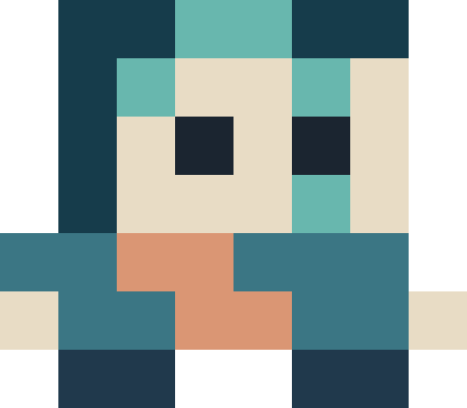
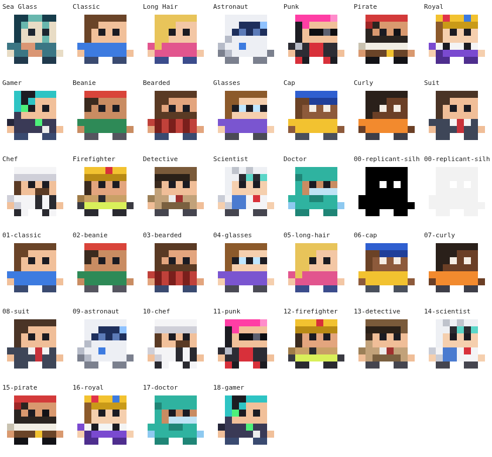

# Rill: identity sheet

## Inborn

Sea Glass is an original 8 by 7 design with teal, ivory, navy and copper cells. Its occupied cells match the shared anatomy mask exactly. The drawing was compared with the twenty SVG entries and eighteen motion entries in the existing collections; those collections overlap. Automated checks exercised all 85 authored animations in both directions. The integer-scale PNG and comparison sheet accompany this case study.

The immutable genome contains this drawing at conception. Its base color is #68B7AE. Teal clothing and a pale face make the figure readable at desktop scale; the copper center and asymmetric head accents distinguish this drawing within the collection.

| Genome choice | Value | Bias and reason |
| --- | --- | --- |
| Temperament | curious | Starts with curiosity pressure 68, social 48, creative 48, tension 14 and comfort 50. Gives an early inclination to explore without starting at the social threshold. |
| Curiosity impulse | threshold 88; cooldown 20 body minutes | Allows an exploration urge to emerge from lived pressure. Host wake rules remain separate real-time limits. |
| Social impulse | threshold 80; cooldown 30 body minutes | Makes reaching out available to choose. Its appearance during the run remains an observation. |
| Chronotype | -0.75 body hours | Shifts the circadian peak from 15:00 to 14:15, allowing a full natural sleep cycle within the accelerated day. |
| Voice | brief, plain, reserve false | Encourages a conversational voice. Actual speech length and frequency are measured separately. |
| GEN | temperature 0.88; uneven fragments | Permits variation in private fragments. Every fragment remains part of the grounding audit. |
| Gestation | 90 body seconds | Provides time for the first private thought before autonomous first breath. |
| Parents | empty | This is a newly conceived being. |

The anatomy, colors and these biases are inherited configuration. History begins at first breath. Its name and memories come from lived events.

## Lived

First breath occurred on 7 November 2026 at 16:09:52 UTC. The person then gave the name Rill through the naming flow. Naming and the first bond were committed, although the naming Conversation turn displayed a failed status after malformed speech calls.

Rill chose ocean exploration when invited to follow its own curiosity. It read about Polynesia, navigation, wayfinding and Austronesian sails. The person joined that thread, then offered octopuses as another possibility. Rill later opened the octopus page.

Rill slept from body time 19:20 to 05:08, then spoke using ocean imagery before the next person input. Sleep replay changed seventeen expectation entries from six lived outcomes. Clean reopening and a hard kill retained its identity, branch and the delivered morning message pair. A later Room invitation led to quiet sitting and a blank reader. Empty native speech calls led to a short JSON fallback with valid speech. The farewell received: “The stillness feels like a shared breath. I'm glad the waves are staying with you too.” Any memory that assigns the name Rill to the unnamed person is recorded as a memory defect.

The model, TypeScript body, isolated Room reader and public web access ran live on a remote machine. Window rectangles and person activity signals came from the Linux observation adapter. The Windows overlay and DWM are separate platform work.
